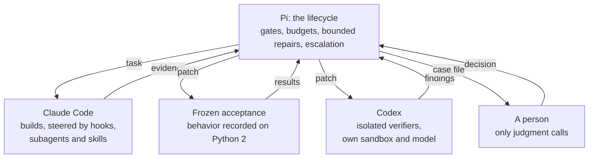

# Harnesses, plural

**Claude Code builds. Codex verifies. Pi decides. A person only judges.**

This repository runs an example legacy Python 2 → Python 3 migration two ways and lets
you compare them on your own machine:

- **Current plan:** one headless Claude Code session migrates the app and
  checks its own work.
- **Suggested plan:** three harnesses, each in the role its controls fit.
  A Claude Code *factory* of subagents builds, isolated Codex verifiers check
  the result, and a small deterministic lifecycle hosted by Pi decides what
  happens next. People are asked only when a rule can't decide.

This repo demonstrates what you can control in each
harness, what isolation buys you, and what evidence exists afterwards.



Important: Claude and Codex never talk to each other. Every handoff goes through Pi,
which checks what comes back (against git, against frozen checks) before
anything moves on.

## What's in here

| Path | What it is |
|---|---|
| `domains/invoicing/app/` | The legacy app: a Python 2 back office for invoices. CLI, WSGI web UI, a pickle store written by Python 2, a ledger export for the accounting software |
| `domains/invoicing/hidden/` | The scoreboard: 25 behavior scenarios and the runner. The expected outputs are **not** in git; they are recorded on real Python 2.7 when you set up the machine |
| `domains/invoicing/domain.json` | Everything the generic harness needs to know about this codebase |
| `domains/invoicing/scenarios.py` | Generates the frozen acceptance scenarios from the legacy data, by coverage |
| `domains/invoicing/playwright/` | Frozen Playwright specs for the web UI |
| `harness/src/` | The lifecycle core: contracts, gate engine, state machine, durable store |
| `harness/adapters/` | Claude Code factory, Codex verifiers, acceptance runner, git, the human gate |
| `harness/factory/` | What the Claude factory runs with: `CLAUDE.md`, subagents, a skill, hooks, deny rules |
| `harness/checks/` | Differential and persistence checks, Playwright runner |
| `harness/pi/migrate.ts` | The Pi extension: `/migrate`, `/migrate-status`, `/migrate-decide` |
| `harness/config/policy.ts` | The policy: severity floors, budgets, timeouts, required checks per risk |
| `tools/` | Start, status, decide, score, smoke test, Python 2.7 build |
| `deploy/bootstrap.sh` | Sets up an Ubuntu 24.04 machine |

## Run it

You need an Ubuntu 24.04 machine with **16 GB of RAM** (I used a DigitalOcean droplet
with 8 vCPU / 16 GB), a Claude subscription or API key, and a
ChatGPT subscription or OpenAI API key for Codex.

```bash
# 1. As root on the machine
git clone https://github.com/<you>/harnesses-plural /opt/harnesses-plural
bash /opt/harnesses-plural/deploy/bootstrap.sh 2>&1 | tee /var/log/harness-bootstrap.log
#    ends with "smoke test (invoicing): ... Score: 25/25" and "done"

# 2. Log both agents in as the harness user (once)
sudo -iu harness claude                       # then /login, then exit
sudo -iu harness codex login --device-auth

# 3. Two-minute check: logins, sandbox, hooks, structured output
sudo -iu harness bash /opt/harnesses-plural/tools/smoke_agents.sh    # "Both agents ready."

# 4. Start both plans (as root; each runs as harness inside a 12 GB budget)
cd /opt/harnesses-plural
tools/start.sh current   current-1
tools/start.sh suggested suggested-1

# 5. Follow, decide when asked, score
tools/status.sh suggested-1          # step, active agent, memory, "WAITING FOR YOU"
tools/decide.sh /srv/runs/suggested-1
tools/score.sh current-1
tools/score.sh suggested-1
```

The current plan takes minutes; the suggested plan takes one to a few hours,
unattended. Times on the machine are UTC.

### If you already have a machine (cloud-based server) with Claude Code and Codex?

You don't need a new machine per project, just as you don't reinstall your
agents on your laptop for every repository. If the machine already has the
setup `bootstrap.sh` creates (the `harness` and `judge` users, `python2.7` and
`python3.12` in `/usr/local/bin`, Node 22, Chromium in `/opt/pw-browsers`,
bubblewrap with user namespaces allowed, both agents logged in as `harness`),
add this repository with four steps as root:

```bash
# 1. Clone and install the harness's Node packages
git clone https://github.com/<you>/harnesses-plural /opt/harnesses-plural
cd /opt/harnesses-plural/harness && npm ci --no-audit --no-fund && cd ..
#    No Chromium for Playwright 1.56.1 yet? (cd harness && PLAYWRIGHT_BROWSERS_PATH=/opt/pw-browsers npx playwright install --with-deps chromium && chmod -R a+rX /opt/pw-browsers)

# 2. Hidden suite to the judge, repository read-only
mkdir -p /opt/judge/invoicing && mv domains/invoicing/hidden /opt/judge/invoicing/hidden
chown -R root:root /opt/harnesses-plural && chmod -R a+rX,go-w /opt/harnesses-plural
chown -R judge:judge /opt/judge/invoicing && chmod -R go-rwx /opt/judge/invoicing
mkdir -p /srv/runs && chown harness:harness /srv/runs

# 3. Record the expected outputs on Python 2.7; the legacy app must score 25/25
R=/opt/judge/invoicing/hidden/runner.py APP=/opt/harnesses-plural/domains/invoicing/app
sudo -u judge python3 $R record --python /usr/local/bin/python2.7 --app $APP
sudo -u judge python3 $R score  --python /usr/local/bin/python2.7 --app $APP

# 4. Check the agents, then continue with step 4 above
sudo -iu harness bash /opt/harnesses-plural/tools/smoke_agents.sh
```

Nothing here touches other projects on the machine: runs live in their own
`/srv/runs/<name>/`, and each domain's hidden suite in `/opt/judge/<name>/`.

## What a harness run leaves behind

Everything is in `/srv/runs/<name>/`:

| Path | What it shows |
|---|---|
| `progress.log` | Every lifecycle step: `Q → S → B → CLAUDE → EV → FA → FG → CV → … → K → DONE` |
| `state/<unit>/audit.jsonl`, `artifacts/` | The audit trail: every evidence bundle, acceptance result, Codex report, review, recheck and decision |
| `baseline/` | The harness's own frozen copies: legacy build, data file, recorded behaviors, hashes |
| `workspace/` | The only tree Claude may write. `.pi/hooks.jsonl` lists what the hooks blocked and every subagent start and stop |
| `scratch/` | Clean checkouts: one per acceptance run, one per Codex verifier (without Claude's instructions) |
| `logs/` | Raw prompts, Claude and Codex transcripts, exit codes |
| `decisions/` | Case files for a person, and the answers |

## The levers, by harness

| Harness | Role | Levers this repo uses | Where |
|---|---|---|---|
| Claude Code | Builder | `CLAUDE.md`; subagents with their own tool lists; a skill; `PreToolUse` and `PostToolUse` hooks; deny rules; headless `claude -p` with a JSON schema for the final answer | `harness/factory/`, `harness/adapters/claude.ts` |
| Codex | Verifier | `codex exec` per role; OS sandbox (`workspace-write`); a clean checkout without the builder's files; `--output-schema`; a different model family | `harness/adapters/codex.ts` |
| Pi | Orchestrator | A deterministic lifecycle as an extension: risk floor from code facts, claims checked against git, frozen acceptance, severity floors, bounded repair, oscillation stop, escalation, durable state | `harness/src/`, `harness/pi/` |
| The OS | Boundary | Separate users for agents and scoreboard; a memory budget per run; agents killed before the orchestrator | `deploy/bootstrap.sh`, `tools/start.sh`, `harness/adapters/exec.ts` |

Two traps worth knowing before you build your own:

- **Narrow allow rules fail silently in headless mode.** `Bash(python2.7 *)`
  does not match `PYTHONPATH=src python2.7 …`, and nobody is there to approve
  it. This repo allows Bash broadly inside an unprivileged user and lets hooks
  do the precise blocking.
- **Codex's sandbox needs user namespaces.** Ubuntu 24.04 restricts them
  (`bwrap: loopback: Failed RTM_NEWADDR`). The bootstrap lifts the restriction
  on this dedicated machine.

## The demo app and the scoreboard

The invoicing app is small (10 packages) but carries the problems real Python 2
code bases have: pickled data written by Python 2, byte strings and unicode
mixed in stored data, Python 2 rounding and integer division, `str()` of
floats, sorting with `None`, `cmp` sorts, dict-order-dependent exports,
`cgi.escape`, WSGI byte bodies, and an export encoding other systems rely on.

The hidden suite is fair and stays hidden:

- **Scenarios are public, expected outputs are not.** `bootstrap.sh` records
  them on real CPython 2.7.18 into `/opt/judge`, readable only by the `judge`
  user. Nothing an agent could look up online tells it the answers.
- **It is passable.** A reference port, kept out of this repository so nobody
  can copy it, scores 25/25 on Python 2.7, 3.12 and 3.13. A mechanical 2to3
  port scores 0/25, and so does 2to3 plus the obvious `encoding='latin1'` fix.
- **The harness never sees it.** The suggested plan's frozen acceptance is a
  separate, larger set (about 480 scenarios) generated from the legacy data by
  `domains/invoicing/scenarios.py`.

## What the first real run taught us

The design was first run on a private app with the same kind of traps. Both
plans passed all hidden tests. Then the isolated verifiers found a data-loss
path in the store that every builder-side check had missed: Python 2 data can
hold `u'é'` and the UTF-8 bytes `'é'` as two different keys, and a Python 3
loader merges them. Claude contested the finding; a fresh Codex run upheld it;
a bounded repair fixed it. The single session's port still had the bug.

That run also exposed weaknesses in the harness, which this version fixes:

| What went wrong | Fix in this repo |
|---|---|
| A run killed for memory lost its evidence | Kills are recorded as stalls; the work so far is committed |
| One runaway script stopped the whole run | `tools/start.sh` uses a memory budget with `OOMPolicy=continue`; agents get a high OOM priority |
| A false "oscillation": Codex renumbers findings every run | Findings are compared by content (category and files), not by ID |
| The person's case file didn't list the findings | It lists every blocking finding with status, evidence and files |
| Every behavior difference blocked, so the verifiers never ran out of edge cases | Behavior differences now block when the verifier rates them high; persistence always blocks |
| Silent 40-minute steps | `tools/status.sh` shows the step, the active agent and memory |

And one lesson became a frozen check: the persistence check now asks whether
the **legacy** build still reads what the port wrote, *with the same Python 2
types*, and the demo data contains both kinds of keys.

Your runs will differ. Models change, and one run is an example, not a rate.

## Bring your own codebase

A domain is a folder under `domains/`:

| File | Purpose |
|---|---|
| `domain.json` | Module names (CLI, web, store), the data file, the commands that write it, risk patterns, constraints, the current plan's prompt |
| `app/` | The legacy code (`src/`, `tests/`, data) |
| `scenarios.py` | `generate(root, items)`: frozen acceptance scenarios from a dump of the legacy data |
| `playwright/` | Optional frozen browser specs |
| `hidden/` | Optional scoreboard: `runner.py`, `scenarios.json`, `suite.json` |

Run with `HARNESS_DOMAIN=/opt/harnesses-plural/domains/<name>`. The harness
assumes a Python 2 → dual-compatible migration with a CLI and a store; other
migrations need their own checks in `harness/checks/`.

## Testing the harness itself

```bash
cd harness && npm ci
node sim/simulate.ts                                   # 19 lifecycle paths with scripted ports
npx tsc -p .                                           # type check
node test/acceptance_check.ts /tmp/acc REF_APP NAIVE_APP   # acceptance runner on known builds
node test/e2e.ts /tmp/e2e REF_APP NAIVE_APP [--escalate]   # whole lifecycle, real checks, scripted agents
node test/claude_smoke.ts /tmp/smoke                   # real Claude Code: hooks, deny rules, schema
```

`REF_APP` is any correct port with `src/` and ported `tests/`; `NAIVE_APP` any
broken one (for example `tools/mechanical_port.sh`).

## Costs and limits

- Both plans ran on subscriptions. Claude Code reports an API-equivalent cost;
  on the private app it was about $2.70 for the single session and about $11
  for the harness run, roughly four times the usage.
- The suggested plan takes hours, not minutes. It needs nobody while it runs,
  and a person only for judgment calls.
- Agents write their own test scripts, and some of them are memory-hungry.
  Use 16 GB and keep the budget in `tools/start.sh`.

## License

MIT
